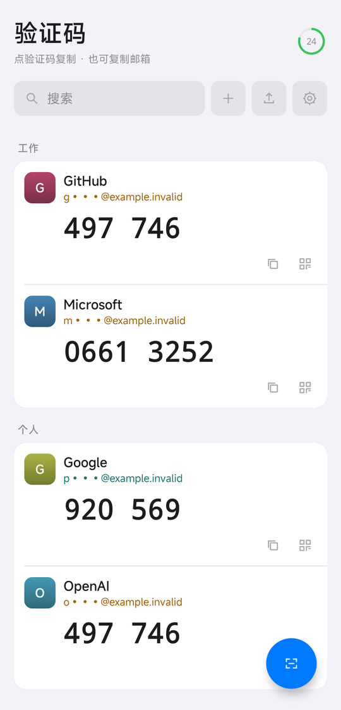
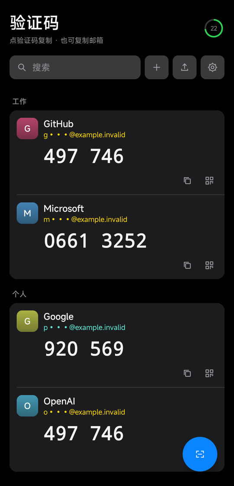
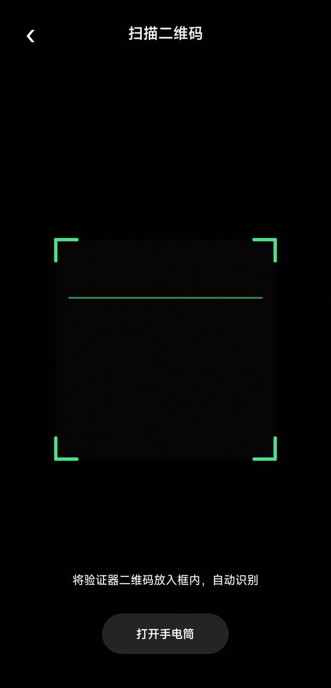
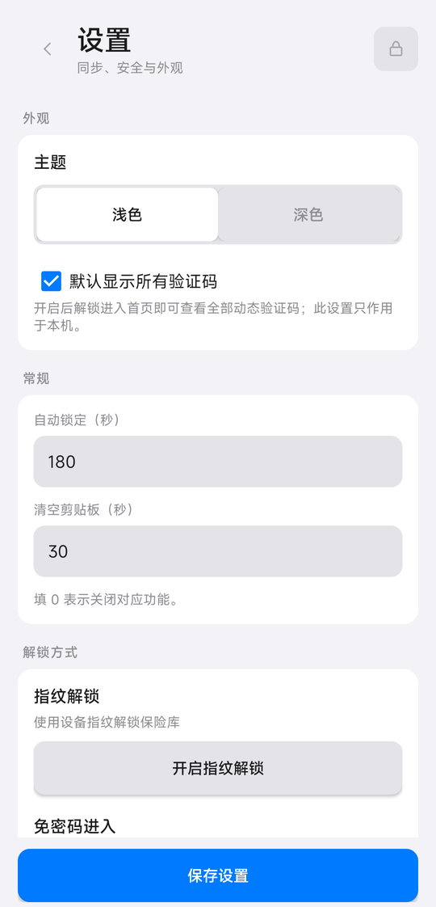
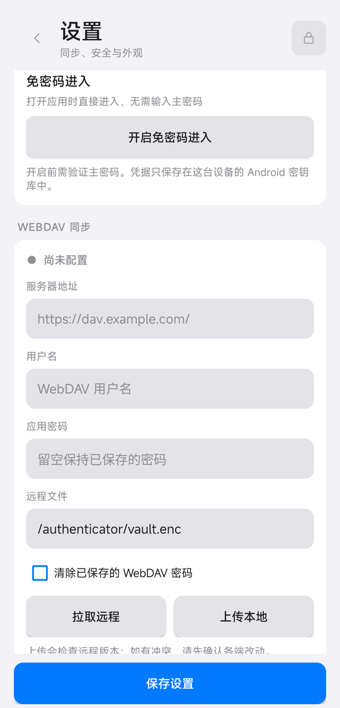
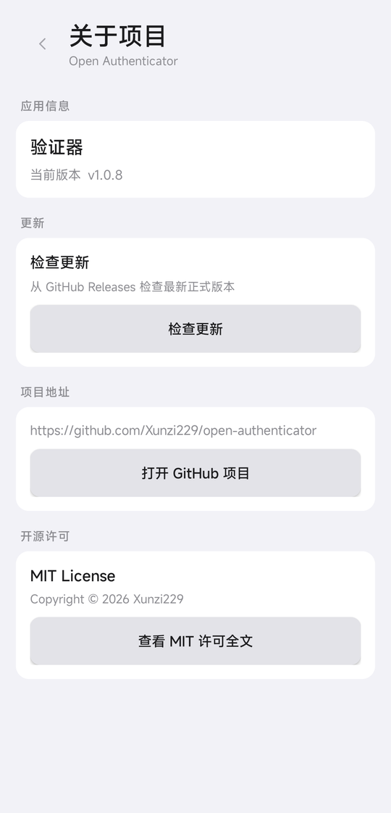

# 验证器

本地加密的跨平台 TOTP 客户端，基于 Rust + [Tauri 2](https://tauri.app/)。

[](https://github.com/Xunzi229/open-authenticator/actions/workflows/ci.yml)
[](https://github.com/Xunzi229/open-authenticator/releases/latest)
[](https://github.com/Xunzi229/open-authenticator/releases)

## 功能

- TOTP（SHA1 / SHA256 / SHA512，6 或 8 位）
- 导入 Google 验证器转移二维码、`otpauth://` 链接、JSON / 文本备份
- 导出备份与可扫描二维码
- 主密码加密保险库；空闲自动锁定；复制后可清空剪贴板
- 可选 Touch ID / Windows Hello 解锁
- 设置中可切换深色 / 浅色主题
- HTTPS WebDAV 同步密文（拉取前会在本地保留一份加密备份）
- 独立目录的 [Android 应用](android/README.md)，支持扫码添加并在新增账号后自动上传 WebDAV

## Android 界面示例

截图来自独立的演示应用，使用虚构账号和公开测试密钥；邮箱均已遮盖，二维码不含真实账号。正式应用仍禁止系统截图。

|  |  |  |
| :---: | :---: | :---: |
| **验证码首页**<br> | **深色主题**<br> | **扫码添加**<br> |
| **外观与解锁**<br> | **WebDAV 同步**<br> | **关于项目**<br> |

## 安装

从 [Releases](https://github.com/Xunzi229/open-authenticator/releases/latest) 下载对应平台的安装包：

| 平台 | 文件 |
| --- | --- |
| Windows | `.msi`，另有 portable `.zip` |
| macOS | Apple Silicon / Intel `.dmg` |
| Linux | 由 Release 提供的桌面包 |
| Android | 固定签名的 `.apk`（Android 8.0 或更高版本） |

Android 源码位于 `android/`。Release 页面中的 Android APK 使用固定调试签名，可覆盖安装此前同签名的测试包；安装前建议备份保险库。

本项目采用 [MIT License](LICENSE)。

macOS 若为 ad-hoc 签名，首次打开需在「系统设置 → 隐私与安全性」中允许。

## 使用

1. 首次启动设置主密码（至少 8 位）
2. 添加账号，或从 Google 验证器 / `otpauth` 导入
3. 点验证码显示，点击即可复制；可单独复制邮箱
4. 设置中可开启指纹解锁、自动锁定和 WebDAV

## 安全

| 项 | 实现 |
| --- | --- |
| 密钥派生 | Argon2id |
| 保险库 | AES-256-GCM 整库加密，默认不落地主密码 |
| 列表 | 不展示密钥，验证码默认打码 |
| 错误密码 | 递增延迟 |
| WebDAV | 仅同步 `vault.enc`；优先 ETag，否则哈希校验防覆盖 |
| 生物识别 | 系统钥匙串 / Windows 凭据保管箱保存主密码，验证通过后才读取 |

生物识别方便解锁，安全边界是当前系统用户，不能替代硬件密钥。

## 数据位置

| 平台 | 路径 |
| --- | --- |
| Windows | `%APPDATA%\Authenticator\vault.enc` |
| macOS | `~/Library/Application Support/Authenticator/vault.enc` |
| Linux | `~/.local/share/authenticator/vault.enc` |

## 开发

需要 Node 22+、Rust stable。Linux 还需 [Tauri 系统依赖](https://v2.tauri.app/start/prerequisites/)。

```sh
npm install
npm run tauri dev
```

```sh
cargo fmt --manifest-path src-tauri/Cargo.toml --check
cargo clippy --locked --manifest-path src-tauri/Cargo.toml --all-targets -- -D warnings
cargo test --locked --manifest-path src-tauri/Cargo.toml
```

`package.json`、`src-tauri/Cargo.toml`、`src-tauri/tauri.conf.json`、`android/app/build.gradle` 中的版本号必须一致。

## 发布

推送 `v*` 标签会触发 [Release](https://github.com/Xunzi229/open-authenticator/actions/workflows/release.yml) 工作流，在 Windows / Linux / macOS 上测试、打包并创建 GitHub Release。带 `-` 的标签为预发布。

未配置签名证书时，稳定版也可产出未签名 Windows 包和 macOS ad-hoc 包。
